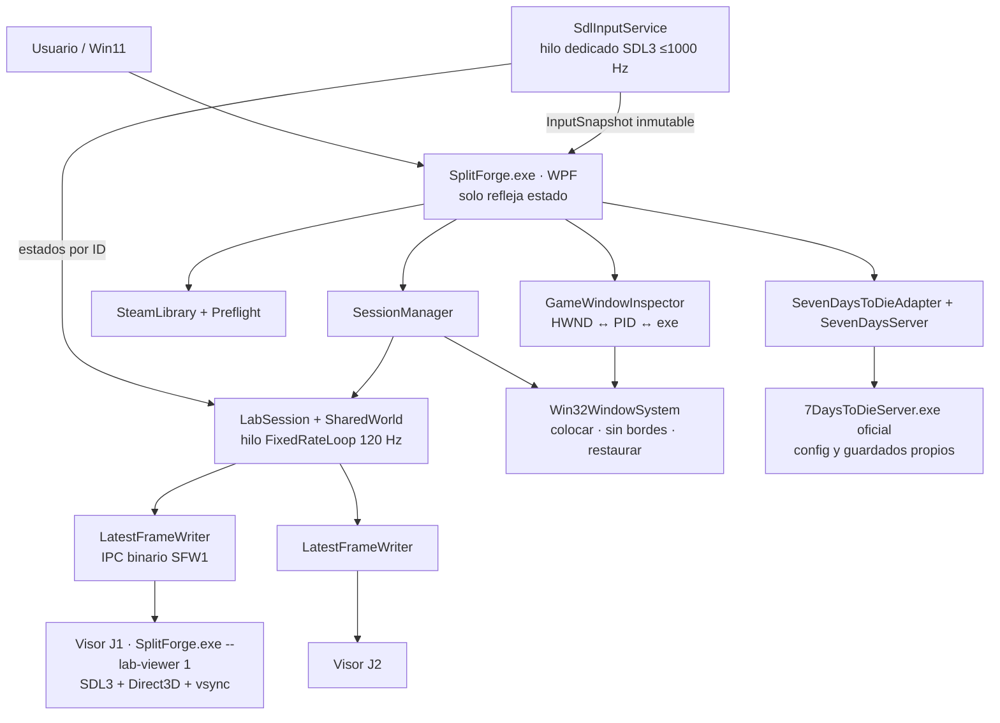
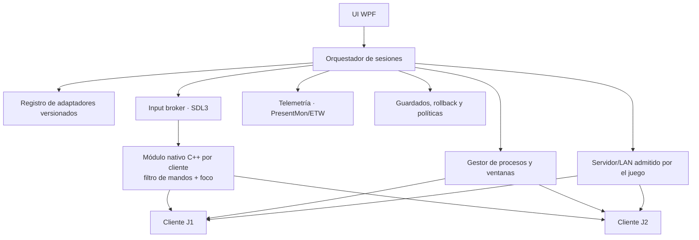

# Arquitectura: situación real y diseño objetivo

> **Atención:** las figuras del bloque **objetivo** son propuestas, **no código implementado**.

## 1. Arquitectura actual 0.7.0 (.NET 10)

- **Hilo de entrada:** único que llama a SDL3 para mandos; publica una instantánea inmutable solo cuando algo cambia. Activa `SDL_JOYSTICK_ALLOW_BACKGROUND_EVENTS` porque el juego tendrá el foco.
- **Hilo de simulación:** `FixedRateLoop` a 120 Hz con temporizador de alta resolución de Windows (`CREATE_WAITABLE_TIMER_HIGH_RESOLUTION`), sin depender del tick de 15,6 ms ni de la interfaz.
- **Interfaz WPF:** temporizador de 33 ms que solo refleja estado; la gestión de sesiones y del servidor se sondea a ~2 Hz.
- **Visores:** el mismo `SplitForge.exe` con `--lab-viewer N`; reciben instantáneas binarias por stdin y dibujan con el renderizador de SDL3. **No son clientes Steam.**
- **Ventanas:** se mueven con Win32 a 2–4 regiones del área útil del monitor principal; el modo sin bordes quita marco/título y se revierte al restaurar.
- **Steam:** lectura de manifiestos con un parser KeyValues propio; preflight conservador; inspección de clientes.
- **7DTD:** servidor dedicado oficial lanzado por SplitForge con `-configfile` propio (plantilla del servidor + ajustes de seguridad), guardados en `%LOCALAPPDATA%\SplitForge\7dtd\UserData`, apagado ordenado por telnet local.
- **Almacenamiento:** `%LOCALAPPDATA%\SplitForge\settings.v2.json`, `splitforge-net.log`, `7dtd\`.

### Características técnicas verificables

- Dos procesos visores creados con `ProcessStartInfo.ArgumentList` (sin shell).
- Un solo estado autoritativo `SharedWorld`, simulado una vez por paso.
- IPC padre→hijos binario `[u32 longitud][SFW1 v1 …]` con límites estrictos (8 KB, 64 disparos, coordenadas finitas en [0,1]); escritor "último fotograma gana".
- `SessionManager` distingue `Lab` y `Attached`; nunca cierra procesos externos.
- Inspección de clientes: 2–4 PID del mismo exe, revalidados justo antes de mover.
- Preflight de 7DTD con estado máximo automático `INSPECCIONADO`.

## 2. Límites actuales

- No hay redirección de un mando por instancia **dentro** de juegos de terceros (módulo nativo pendiente).
- No hay compositor DirectX ni telemetría de frametimes/VRAM.
- La segunda sesión de Steam depende de otro usuario de Windows o de Sandboxie-Plus; SplitForge no gestiona credenciales.
- El protocolo de laboratorio no es una API de plugins.

## 3. Arquitectura objetivo modular (propuesta)

### Principios

1. **Adaptadores versionados** por juego/build con capacidades probadas, requisitos y bloqueos.
2. **Separar control y datos:** la UI orquesta; los hilos críticos (entrada, simulación) no dependen de ella.
3. **Preflight antes de lanzar:** instalación, modo de red, mandos, guardados y recuperación.
4. **Operaciones reversibles:** snapshot de ventanas y estilos; restauración al detener; no terminar procesos externos.
5. **Fail closed:** si falta una condición crítica, detener con un motivo observable.
6. **Métricas antes de optimizar:** frametime P95/P99, FPS por instancia, memoria/VRAM, CPU y latencia de entrada.

### Elección del compositor

Ventanas nativas sin bordes y división Win32 (implementado). Composición DirectX solo si una matriz de pruebas muestra mejora tangible. El compositor no convierte un juego no cooperativo en cooperativo.

### Definición de sesión comercial exitosa

**La misma partida** visible para ambos jugadores; cada mando controla una sola instancia; guardados intactos; cierre y restauración seguros; límites offline documentados. Dos ventanas organizadas sin estas condiciones **no cuentan**.
