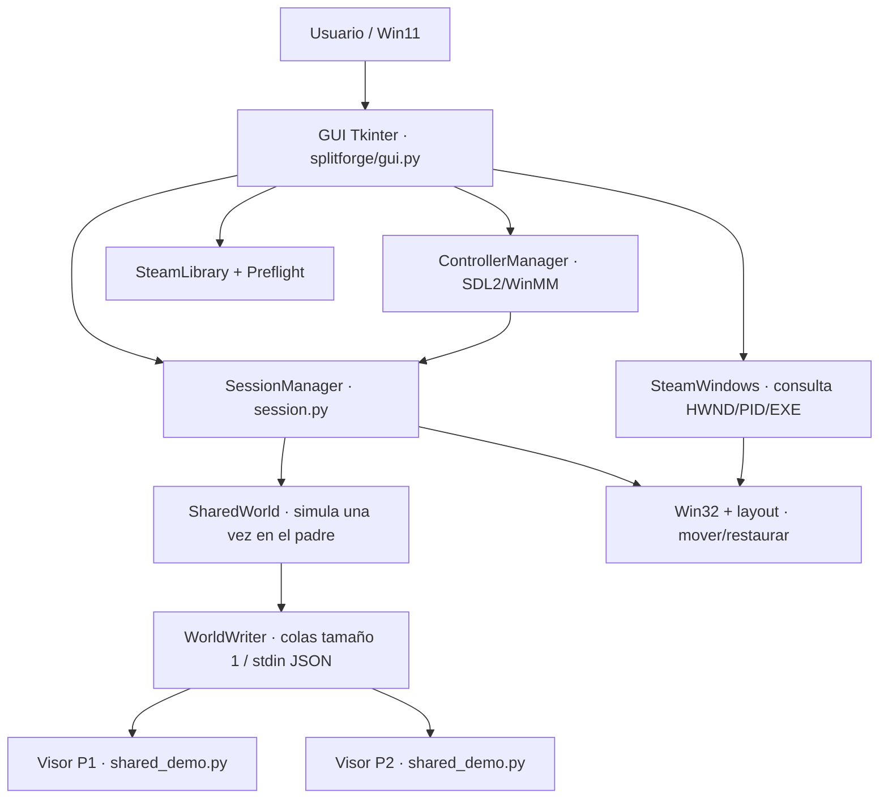
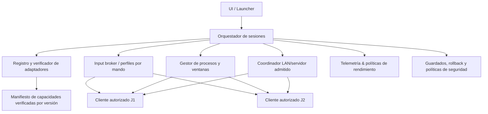

# Arquitectura: situación real y diseño objetivo

> **Atención:** las figuras del bloque **objetivo** son propuestas, **no código implementado**.

## 1. Arquitectura actual v0.6.0

- **Padre (GUI):** posee los mandos SDL, orquesta procesos, ejecuta mundo local y emite instantáneas.
- **Hijos:** visores Python; reciben JSON lineal por `stdin`, dibujan un estado compartido. **No son clientes Steam**.
- **Ventanas:** se mueven con Win32 a dos regiones; se guardan/restauran ubicaciones cuando es posible.
- **Steam:** lectura de `appmanifest_*.acf`, evaluación conservadora y correlación de ventanas Win32; sin cambiar instalaciones o credenciales.
- **Almacenamiento:** preferencias y log en `%LOCALAPPDATA%\SplitForge\` (o `~/.splitforge` si falta la variable, solo para tests).

### Características técnicas verificables

- Dos procesos de visor creados con `subprocess.Popen`.
- Un solo estado autoritativo `SharedWorld` ejecutado por el proceso UI.
- Comunicación local padre→hijos basada en líneas JSON, sin sockets ni servidor público.
- Cola `WorldWriter` de capacidad 1: se reemplazan instantáneas antiguas bajo congestión (prioridad a la última).
- El `SessionManager` distingue `demo`, `shared_demo`, `external` y `attached`.
- La herramienta Steam consulta ventanas de manera conservadora; requiere 2 PID con mismo EXE para permitir *organización visual*. No demuestra multijugador.

## 2. Límites del prototipo actual

- La GUI Tkinter y el mundo corren en el mismo proceso; no hay servicio Core aislado.
- El estado viaja por texto JSON/stdio; no es una API estandarizada de plugins ni un protocolo versionado.
- No hay compositor DirectX, limitador de FPS universal, telemetría de VRAM o QoS automático.
- No hay redirección general de entrada hacia aplicaciones Steam de terceros.
- No hay proceso que duplique legítimamente sesiones de Steam; ni sistema de cuentas múltiples.
- No hay un adaptador que instale, inicie o sincronice una sesión cooperativa real.

## 3. Arquitectura objetivo modular (propuesta)

### Principios

1. **Adaptadores versionados** por juego/build y plataforma: describen capacidades probadas, requisitos y bloqueos; no ejecutan código arbitrario sin permisos/validación.
2. **Separar control y dataplane:** UI orquesta; módulos críticos consumen recursos mínimos y registran estado. No migrar a C++ hasta justificarlo con perfilado.
3. **Preflight antes del lanzamiento:** licencia, launcher, cliente(s), modo red, mandos, guardados, espacio/disponibilidad y recuperación.
4. **Operaciones reversibles:** snapshot de ventanas y de archivos editados explícitamente, restauración al detener, no terminar procesos externos.
5. **Fail closed:** si falta condición crítica (dos clientes autorizados, anti-cheat, LAN), detener la integración con un motivo observable.
6. **Métricas antes de optimizar:** frametime P95/P99, FPS por instancia, memoria/VRAM, CPU y latencia de entrada.

### Elección del compositor

Primero ventanas nativas sin bordes y división Win32. Solo introducir composición DirectX 11 cuando una matriz de pruebas muestre una mejora tangible y compatibilidad legal. El compositor no puede convertir por sí solo un juego no cooperativo en coop.

### Definición de sesión comercial exitosa

**La misma partida** del juego debe mostrar a ambos jugadores; cada mando debe controlar a una sola instancia, guardados no dañados, cuentas legítimas cuando se requieran, cierre/restauración seguros y límites offline documentados. Dos ventanas organizadas sin estas condiciones **no cuentan**.
