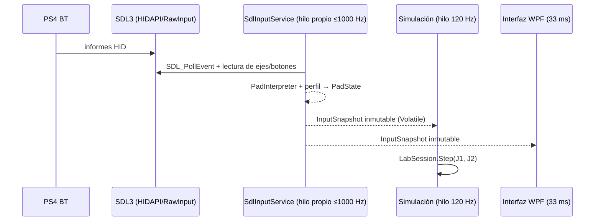

# Controles PS4, SDL3 y separación de jugadores

## Estado comprobado en el equipo de referencia (prototipo Python)

- Dos mandos Bluetooth como `Wireless Controller` en Windows y `PS4 Controller` en SDL2 (pygame-ce 2.5.8).
- La vía `pygame.joystick` detectó ambos y permitió movimientos separados en el laboratorio.
- Esto **no** equivale a redirigir mandos dentro de juegos de Steam de terceros.

## Ruta de entrada en 0.7 (.NET + SDL3)

- **Un solo hilo toca SDL.** Publica una instantánea nueva solo cuando cambia algo (sin basura a 1 kHz) y al menos una vez por segundo.
- **Eventos en segundo plano** (`SDL_JOYSTICK_ALLOW_BACKGROUND_EVENTS=1`): imprescindible, el juego tendrá el foco.
- **Frecuencia:** plazos absolutos con `SDL_DelayNS` (temporizador de alta resolución de SDL3, sin girar la CPU). Medido: **1000 Hz en Windows** (VM de la CI, run #2) y en Linux tras la corrección; la primera versión midió 646 Hz por acumulación de retrasos.
- **Hotplug:** `SDL_EVENT_JOYSTICK_ADDED/REMOVED`; un mando desconectado deja de aparecer y el jugador queda en `SIN LECTURA`; nunca se intercambian J1/J2 en silencio.
- **Identificación física:** `IdentifyPlayer` enciende la barra de luz del PS4 con el color del jugador (J1 turquesa, J2 naranja, J3 violeta, J4 amarillo), fija el índice de jugador y vibra 250 ms.

## Política de lectura (ADR-002, vigente)

`ReadPathPolicy.Choose`: en modo **Auto**, nombres PS4/DualShock/Wireless Controller/PlayStation → **joystick directo** con perfil aprendido; el resto usa la ruta **Gamepad** estándar de SDL si existe. Modos manuales: Joystick / Gamepad. En SDL3 la ruta Gamepad para PS4 es sólida (HIDAPI); conviene probarla con «Lector: Gamepad» y, si funciona en el PC del propietario, plantear cambiar el valor por defecto con un ADR.

## Calibración

- Ejes X/Y: zona muerta por eje 0,14 y reescalado (`AxisMath.Normalize`, idéntico al prototipo), inversión opcional.
- Acciones: disparo (Cruz o R2 analógico), impulso, escudo; índices aprendidos con «Aprender».
- R2 analógico: se guardan reposo, dirección y umbral 0,60 (`AnalogTriggerPressed`).
- Perfil por GUID de modelo (los dos PS4 comparten perfil). Los GUID de SDL3 pueden diferir de los de SDL2: hay que recalibrar una vez en la 0.7.
- Perfil inválido para el dispositivo → sin estado (`SIN LECTURA`) hasta recalibrar; nunca índices fuera de rango.

## Pruebas manuales mínimas

1. `joy.cpl`: ambos figuran y responden en *Propiedades → Probar*.
2. `SplitForge.Diagnostico.exe mandos`: aparecen los dos y cambian X/Y **con otra ventana en primer plano**.
3. Pestaña **01 MANDOS**: estado en vivo; frecuencia del hilo cercana a 1000 Hz; «Identificar» enciende las luces.
4. Pestaña **02 MUNDO COMPARTIDO**: cada mando mueve **su** nave; disparo, escudo e impulso por separado.
5. Desconectar/reconectar uno; reasignar en vivo.

## Un mando por ventana dentro del juego (módulo nativo C++)

Windows suele entregar el mando solo a la ventana con foco (Windows.Gaming.Input), mientras que XInput funciona en segundo plano. Antes de escribir el módulo nativo hay que saber qué API usa cada juego: `SplitForge.Diagnostico.exe 7dtd` lista los módulos de entrada cargados (XInput, DirectInput, HID, Windows.Gaming.Input, SDL, overlay de Steam, EAC). Opciones según la evidencia:

- **XInput → implementado (experimental, ADR-015):** `native/SplitForge.XInputFilter` se instala desde la pestaña 06 («Instalar filtro» / «Asignar mandos a los clientes» / «Quitar filtro»). Cada cliente ve solo su ranura; los PS4 deben llegar como XInput (Steam Input o DS4Windows) y sin duplicados. Cada proceso que lo carga escribe `estado-PID.txt` (DLL, real cargada, ranura) para comprobarlo.
- **Windows.Gaming.Input / foco:** además, simular foco por proceso (técnica de Nucleus Co-op), solo con EAC desactivado mediante la opción oficial.
- Nunca intervenir en antitrampas activos ni instalar drivers de kernel por defecto.
