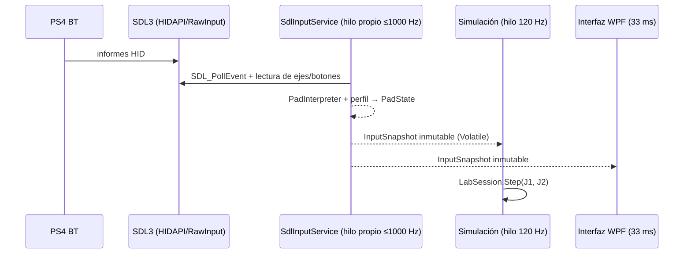

# Controles PS4, SDL3 y separación de jugadores

## Estado comprobado en el equipo de referencia (prototipo Python)

- Dos mandos Bluetooth como `Wireless Controller` en Windows y `PS4 Controller` en SDL2 (pygame-ce 2.5.8).
- La vía `pygame.joystick` detectó ambos y permitió movimientos separados en el laboratorio.
- Esto **no** equivale a redirigir mandos dentro de juegos de Steam de terceros.

## Ruta de entrada en 0.7 (.NET + SDL3)

- **Un solo hilo toca SDL.** Publica una instantánea nueva solo cuando cambia algo (sin basura a 1 kHz) y al menos una vez por segundo.
- **Eventos en segundo plano** (`SDL_JOYSTICK_ALLOW_BACKGROUND_EVENTS=1`): imprescindible, el juego tendrá el foco.
- **Frecuencia:** plazos absolutos con `SDL_DelayNS` (temporizador de alta resolución de SDL3, sin girar la CPU). Medido: **1000 Hz en Windows** (VM de la CI, run #2; PC del propietario, 2026-10-10, sin mandos) y en Linux tras la corrección; la primera versión midió 646 Hz por acumulación de retrasos.
- **Hotplug:** `SDL_EVENT_JOYSTICK_ADDED/REMOVED`; un mando desconectado deja de aparecer y el jugador queda en `SIN LECTURA`; nunca se intercambian J1/J2 en silencio.
- **Identificación física:** `IdentifyPlayer` enciende la barra de luz del PS4 con el color del jugador (J1 turquesa, J2 naranja, J3 violeta, J4 amarillo), fija el índice de jugador y vibra 250 ms.
- **Tipo y carga en vivo:** la pestaña «01 MANDOS» muestra el tipo legible de cada mando (PlayStation 4/5, Xbox 360/One, estándar o genérico HID) y su carga en tiempo real (`SDL_GetJoystickPowerInfo`, leída una vez por segundo): «Batería 80%», «Cargando 45%», «Cargado» o «Cable». Con `?` cuando el mando por Bluetooth no informa el porcentaje.

## Política de lectura (ADR-002, vigente)

`ReadPathPolicy.Choose`: en modo **Auto**, nombres PS4/DualShock/Wireless Controller/PlayStation → **joystick directo** con perfil aprendido; el resto usa la ruta **Gamepad** estándar de SDL si existe. Modos manuales: Joystick / Gamepad. En SDL3 la ruta Gamepad para PS4 es sólida (HIDAPI); conviene probarla con «Lector: Gamepad» y, si funciona en el PC del propietario, plantear cambiar el valor por defecto con un ADR.

## Calibración

- Ejes X/Y: zona muerta por eje 0,14 y reescalado (`AxisMath.Normalize`, idéntico al prototipo), inversión opcional.
- Acciones: disparo (Cruz o R2 analógico), impulso, escudo; índices aprendidos con «Aprender».
- R2 analógico: se guardan reposo, dirección y umbral 0,60 (`AnalogTriggerPressed`).
- Perfil por GUID de modelo (los dos PS4 comparten perfil). Los GUID de SDL3 pueden diferir de los de SDL2: hay que recalibrar una vez en la 0.7.
- Perfil inválido para el dispositivo → sin estado (`SIN LECTURA`) hasta recalibrar; nunca índices fuera de rango.

## Pruebas manuales mínimas

1. `joy.cpl`: ambos figuran y responden en *Propiedades → Probar*.
2. `SplitForge.Diagnostico.exe mandos`: aparecen los dos y cambian X/Y **con otra ventana en primer plano**.
3. Pestaña **01 MANDOS**: tipo de cada mando, carga en vivo, estado en vivo; frecuencia del hilo cercana a 1000 Hz; «Identificar» enciende las luces.
4. Pestaña **02 MUNDO COMPARTIDO**: cada mando mueve **su** nave; disparo, escudo e impulso por separado.
5. Desconectar/reconectar uno; reasignar en vivo.

## Un mando por ventana dentro del juego (módulo nativo C++)

Windows suele entregar el mando solo a la ventana con foco (Windows.Gaming.Input), mientras que XInput funciona en segundo plano. Antes de escribir el módulo nativo hay que saber qué API usa cada juego: `SplitForge.Diagnostico.exe 7dtd` lista los módulos de entrada cargados (XInput, DirectInput, HID, Windows.Gaming.Input, SDL, overlay de Steam, EAC). Opciones según la evidencia:

- **XInput → implementado (experimental, ADR-015):** `native/SplitForge.XInputFilter` se instala con «Preparar ahora» en la pantalla JUGAR (donde también está «Detectar» por jugador) y se gestiona en AVANZADO › 7 Days to Die: «Instalar filtro», «Asignar mandos a los clientes» y «Quitar filtro».
  - Cada cliente ve solo su ranura, y los mandos deben llegar como XInput sin duplicados.
  - Cada copia cargada escribe `estado-PID-<dll>.txt` con la DLL, si cargó la real, la ranura, las lecturas, cuántas llegaron por la XInput real interceptada y si la intercepción está activa.
  - La DLL real es siempre `xinput1_4.dll` de System32 y el filtro redirige sus exportaciones hacia sí mismo (ADR-021): un módulo del juego que la pida por su cuenta también ve un solo mando. En 7DTD, Unity usa la copia `xinput1_3` e InControlNative la 1.4 real interceptada.
- **Ranuras XInput:** XInput numera los mandos del 1 al 4. «Detectar» pide pulsar un botón en el mando de cada jugador y elige su ranura; también lo hace `SplitForge.Diagnostico.exe xinput`. La lectura se hace en un hilo de fondo, nunca en el de la interfaz.
- **PC del propietario (2026-10-10):**
  - SDL3 ve los dos mandos como `Xbox 360 Controller`, es decir, como XInput.
  - Están instalados ViGEmBus (mandos virtuales) y HidHide (oculta los HID originales). Encaja con PS4 convertidos en mandos Xbox 360 virtuales; la herramienta que los crea no se ha identificado (supuesto).
  - El hilo de entrada SDL3 3.5.0 mide 1000 Hz (`mandos`, sin mandos conectados en esa medición).
- **Windows.Gaming.Input / foco:** además, simular foco por proceso (técnica de Nucleus Co-op), solo con EAC desactivado mediante la opción oficial.
- **Puntero propio (ADR-025):** Windows tiene un solo puntero y cada juego lo recoloca y lo encierra en su ventana. El cliente que no es la ventana activa usa uno propio dentro del filtro: no mueve ni encierra el de Windows, y el puntero de sus menús con mando no salta. Para usar el ratón en un cliente hay que hacer clic en él. **Pendiente de probar con los mandos (W23).**
- **Teclas que no se quedan pegadas (ADR-026):** al cambiar de ventana con Alt+Tab, la que pierde el foco se quedaba con Alt pulsada (el foco simulado le oculta la desactivación, que es cuando Unity suelta las teclas) y en 7DTD LB/RB dejaban de cambiar de objeto. El filtro le entrega al juego el «soltar» de cada tecla al perder el foco de verdad. Comprobado con el juego real; falta la confirmación del propietario con los mandos.
- **Bloqueo de entrada «solo mandos» (Ctrl+Alt+B, ADR-019):** el teclado y el ratón dejan de llegar a los juegos y al escritorio; los mandos siguen funcionando. Se suelta con el mismo atajo. Un cartel en pantalla avisa al bloquear y al desbloquear, y una insignia queda visible mientras dura el bloqueo.
- **Evidencia (2026-10-10, dos clientes de 7DTD):** el filtro se carga por `xinput1_3.dll`, J1 solo ve el mando 1 y J2 el mando 2, y ambos consultan su mando unas 60 veces por segundo también sin foco. Esas eran las lecturas de Unity; InControlNative leía por la `xinput1_4.dll` real y veía los dos mandos hasta ADR-021. Ahora InControl lista un solo mando en cada cliente.
- Sin drivers de kernel por defecto.
