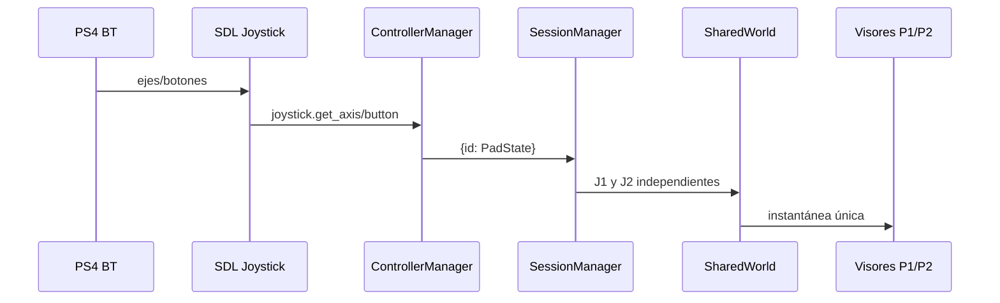

# Controles PS4, SDL y separación de jugadores

## Estado comprobado en el equipo de referencia

- Dos mandos Bluetooth figuraron como `Wireless Controller` en Windows y como `PS4 Controller` en SDL.
- `pygame-ce 2.5.8` utiliza SDL 2.32.10 en el entorno reportado por el usuario.
- La vía `pygame.joystick` detectó ambos (`get_count() == 2`) y finalmente permitió movimientos separados.
- El **laboratorio** puede asignar un identificador distinto a J1/J2 y reenviar cada estado al mundo compartido.
- Esto **no** equivale a redirigir mandos dentro de juegos de Steam de terceros.

## Ruta real de entrada



`ControllerManager.choose_read_path()` usa `joystick` por defecto para nombres PS4/DualShock/Wireless Controller, aun cuando SDL ofrezca GameController. Otros mandos pueden usar mapeo normalizado. Si SDL falla totalmente, existe fallback WinMM (limitado). **No mezclar** los dos lectores para el mismo dispositivo: crea duplicación.

## Calibración

- Ejes X/Y: zona muerta (`normalize_axis`, por defecto 0.14), inversión y mapeo.
- Acciones: Cruz/R2 o botones asignados como `a_pressed`, `dash_pressed`, `shield_pressed`.
- El índice físico del botón no es universal; aprenderlo con el usuario.
- R2 puede ser un eje analógico: guardar reposo, dirección y umbral (`analog_trigger_pressed`).
- Mando desconectado: reportar `SIN LECTURA`, no intercambiar J1/J2 por una reenumeración silenciosa.

## Pruebas manuales mínimas

1. `joy.cpl`: ambos figuran y cada uno responde en *Propiedades → Probar*.
2. Diagnóstico SDL desde carpeta raíz en PowerShell:

   ```powershell
   .\.venv\Scripts\python.exe -c "import pygame; pygame.init(); pygame.joystick.init(); print(pygame.joystick.get_count()); [print(i, pygame.joystick.Joystick(i).get_name()) for i in range(pygame.joystick.get_count())]"
   ```
3. SplitForge pestaña **01 CONTROLES**: los dos aparecen; X/Y cambia en tiempo real.
4. Selección J1/J2: cada uno con un ID distinto. Iniciar **02 MUNDO COMPARTIDO**.
5. Cada mando mueve **su** personaje, sin mover el otro; disparo, escudo e impulso por separado.
6. Desconectar/reconectar uno; verificar estado reportado y reasignación explícita.

## Camino pendiente para juegos de Steam

Un broker nativo **podría** requerir control de visibilidad de mandos y asignación por proceso mediante mecanismos permitidos. **No existe hoy** en SplitForge. Antes de elegir driver o técnica, realizar una prueba legal por juego, determinar cómo lee input y analizar si admite usuarios separados. Steam Input puede reconocer un mando sin exponerlo a SDL del modo esperado. Nunca intervenir en protecciones antitrampas ni asumir que un driver virtual resuelve el problema de multijugador.
