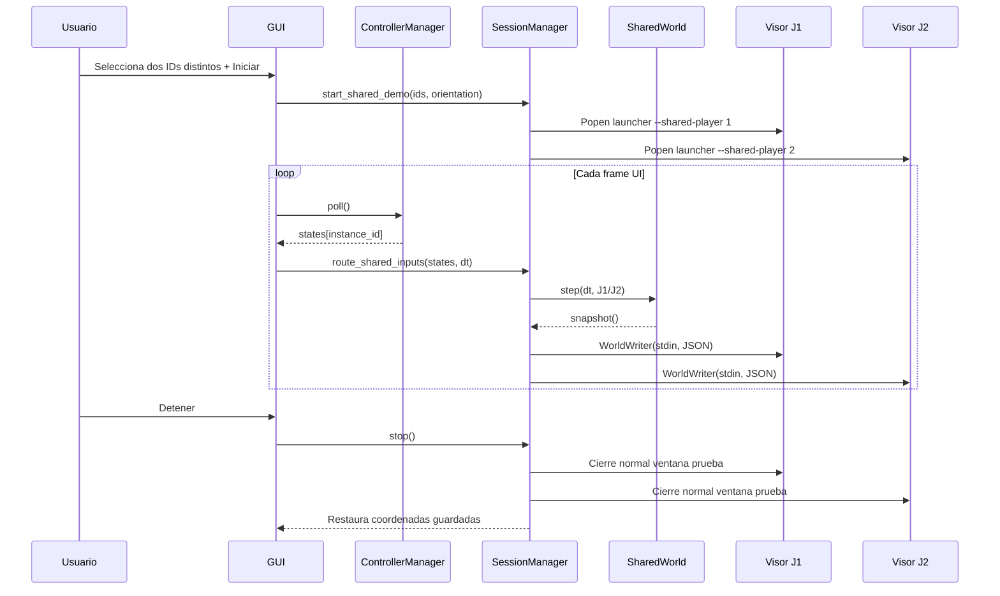
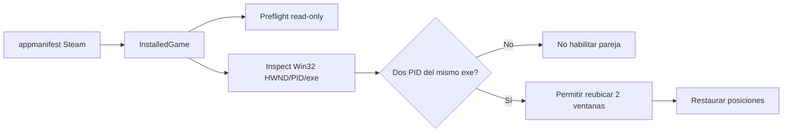

# Flujos de ejecución, IPC y persistencia

## Iniciar Mundo Compartido



## Instantánea actual (ejemplo ilustrativo)

```json
{
  "type": "world",
  "frame": 120,
  "actors": {
    "1": {"x": 0.25, "y": 0.5, "score": 1, "hits": 0, "shield": false, "connected": true},
    "2": {"x": 0.75, "y": 0.5, "score": 0, "hits": 0, "shield": true, "connected": true}
  },
  "shots": [],
  "orb": [0.5, 0.5],
  "event": "Ambos jugadores en la misma arena"
}
```

La instantánea se envía en una línea JSON con `WorldWriter` y se valida parcialmente en `validate_world()`. La cola de salida tiene máximo **un mensaje pendiente** para preferir el último frame si el visor no consume a tiempo. Este esquema no tiene aún identificador de protocolo ni garantía de fiabilidad/replay: no usarlo sin revisión para partidas comerciales.

## Diagrama Steam (solo diagnóstico)



## Persistencia

- `%LOCALAPPDATA%\SplitForge\settings.json`: asignaciones/calibración/opciones; no se deben borrar automáticamente.
- `%LOCALAPPDATA%\SplitForge\splitforge.log`: errores/eventos locales; revisar privacidad antes de compartir.
- Los juegos Steam guardan sus partidas según su propio sistema. SplitForge v0.6 **no** debe gestionarlas ni modificarlas.
- Los reportes `SplitForge_Reporte_*.json` son salidas compartibles tras sanitización.
