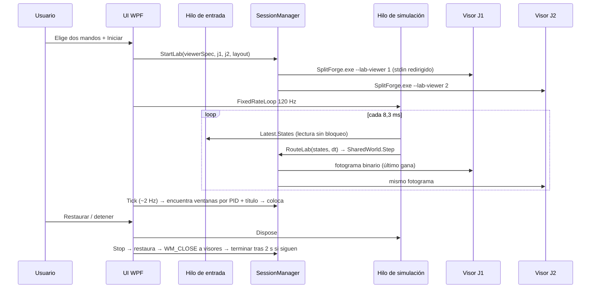
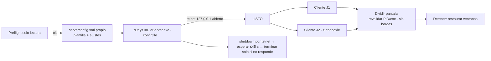
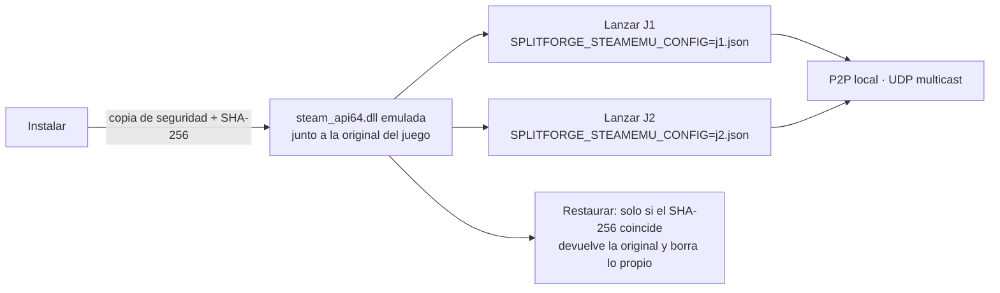

# Flujos de ejecución, hilos, IPC y persistencia

## Hilos de SplitForge.exe (0.7)

| Hilo | Frecuencia | Responsabilidad |
| --- | --- | --- |
| Interfaz WPF | temporizador 33 ms; tareas lentas ~2 Hz | Reflejar estado, comandos del usuario, `SessionManager.Tick`, estado del servidor |
| `SplitForge.Input` | ≤1000 Hz | Único que llama a SDL3 para mandos; publica `InputSnapshot` |
| `SplitForge.Lab` | 120 Hz | `LabSession.Step` + envío a visores (solo con laboratorio activo) |
| `SplitForge.LabWriter.Pn` | según llegan fotogramas | Escribir el último fotograma en el stdin de cada visor |
| Tareas en segundo plano de la pestaña 06 | a petición y en el refresco de estado | `XInputProbe` (ranuras XInput, «Detectar»), estado del filtro y del servidor; nunca en el hilo de la interfaz |

## Iniciar Mundo Compartido



## Instantánea del mundo (binario SFW1 v1)

```
u32 longitud | u32 "SFW1" | u16 versión | i64 fotograma
J1: f32 x, f32 y, i32 núcleos, i32 impactos, u8 banderas(escudo|conectado)
J2: ídem
f32 orbe_x, f32 orbe_y | u16 n_disparos | n × (f32 x, f32 y, u8 dueño)
u16 n_bytes_evento | evento UTF-8 (≤512 bytes)
```

El visor descarta cargas inválidas (magia, versión, rangos, NaN, bytes sobrantes) y considera caducado un fotograma de más de 1 s.

## 7 Days to Die



## Emulador de Steam (pestaña 07)



«Lanzar J1 y J2» (ADR-018):
1. Calcula el panel de cada jugador con la distribución de la barra inferior, el mínimo 16:9 de 7DTD y, si está activo, el monitor completo.
2. Lanza J1 y, 1,5 s después, J2 con su identidad y `-crossplatform=None -serverplatforms=Steam -noeac -screen-fullscreen 0 -popupwindow -screen-width/-height`.
3. Si el filtro XInput está instalado, escribe la asignación por PID (J1 → mando de J1, J2 → mando de J2); el filtro la relee en vivo.
4. A ≈2 Hz, desde 12 s después, busca las ventanas «7 Days To Die» de esos PID y abre la sesión de pantalla dividida (restaurable al detener).

## Persistencia

- `%LOCALAPPDATA%\SplitForge\settings.v2.json`: distribución, modo de lectura, frecuencia de entrada, perfiles de mandos por GUID, opciones del servidor 7DTD. Escritura atómica.
- `%LOCALAPPDATA%\SplitForge\settings.json`: del prototipo Python; la 0.7 solo lo lee una vez para importar preferencias.
- `%LOCALAPPDATA%\SplitForge\splitforge-net.log`: eventos con identificador de sesión; rota a `.old` al superar 2 MB.
- `%LOCALAPPDATA%\SplitForge\7dtd\`: `serverconfig.xml`, `UserData\` (mundos y guardados del servidor local), `logs\`.
- `%LOCALAPPDATA%\SplitForge\sesion-ventanas.json`: solo mientras hay ventanas externas modificadas; se borra al detener. Si existe al arrancar (cierre inesperado), se restauran las ventanas cuyo handle sigue siendo del mismo PID.
- `%LOCALAPPDATA%\SplitForge\xinput\`: `asignacion.txt` (líneas `PID RANURA`, escrita por SplitForge) y `estado-PID-<dll>.txt` (escrito por cada copia del filtro con reemplazo atómico). Para el jugador 2 en Sandboxie, el estado queda dentro del sandbox `SplitForge_J2`.
- `%LOCALAPPDATA%\SplitForge\steamemu\`: `j1.json` y `j2.json` (identidades que se pasan por `SPLITFORGE_STEAMEMU_CONFIG`) y una carpeta de guardados por identidad (`<appid>-J1`, `<appid>-J2`, con `remote\` y `userdata\`). Registro nativo en `%LOCALAPPDATA%\SplitForge\steamemu.log`.
- Carpeta del juego (solo con el emulador instalado): `steam_api64_splitforge_original.dll` (copia de la original), `SplitForge.SteamEmu.json` y `SplitForge.SteamEmu.estado.txt` (SHA-256 de la DLL instalada).
- Carpeta del juego (solo con el filtro instalado): copias del filtro con los nombres de XInput que carga el juego y su manifiesto `splitforge-xinput.json`.
- Los juegos guardan sus partidas según su sistema; SplitForge no las toca.
- `SplitForge_Reporte_*.json`: salidas compartibles ya saneadas.
