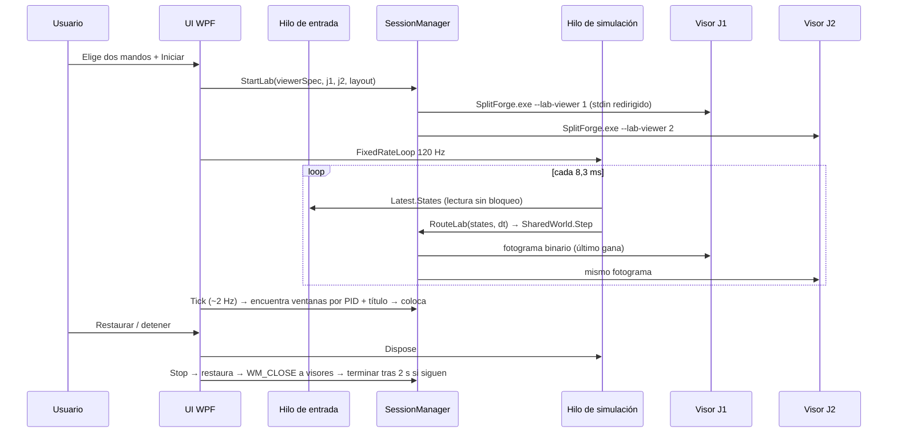
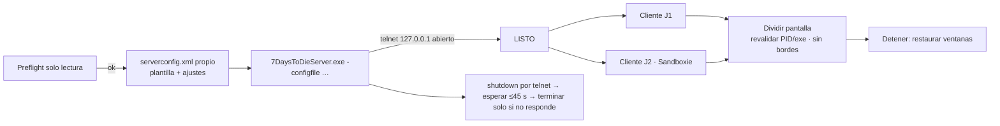

# Flujos de ejecución, hilos, IPC y persistencia

## Hilos de SplitForge.exe (0.7)

| Hilo | Frecuencia | Responsabilidad |
| --- | --- | --- |
| Interfaz WPF | temporizador 33 ms; tareas lentas ~2 Hz | Reflejar estado, comandos del usuario, `SessionManager.Tick`, estado del servidor |
| `SplitForge.Input` | ≤1000 Hz | Único que llama a SDL3 para mandos; publica `InputSnapshot` |
| `SplitForge.Lab` | 120 Hz | `LabSession.Step` + envío a visores (solo con laboratorio activo) |
| `SplitForge.LabWriter.Pn` | según llegan fotogramas | Escribir el último fotograma en el stdin de cada visor |

## Iniciar Mundo Compartido



## Instantánea del mundo (binario SFW1 v1)

```
u32 longitud | u32 "SFW1" | u16 versión | i64 fotograma
J1: f32 x, f32 y, i32 núcleos, i32 impactos, u8 banderas(escudo|conectado)
J2: ídem
f32 orbe_x, f32 orbe_y | u16 n_disparos | n × (f32 x, f32 y, u8 dueño)
u16 n_bytes_evento | evento UTF-8 (≤512 bytes)
```

El visor descarta cargas inválidas (magia, versión, rangos, NaN, bytes sobrantes) y considera caducado un fotograma de más de 1 s.

## 7 Days to Die



## Persistencia

- `%LOCALAPPDATA%\SplitForge\settings.v2.json`: distribución, modo de lectura, frecuencia de entrada, perfiles de mandos por GUID, opciones del servidor 7DTD. Escritura atómica.
- `%LOCALAPPDATA%\SplitForge\settings.json`: del prototipo Python; la 0.7 solo lo lee una vez para importar preferencias.
- `%LOCALAPPDATA%\SplitForge\splitforge-net.log`: eventos con identificador de sesión; rota a `.old` al superar 2 MB.
- `%LOCALAPPDATA%\SplitForge\7dtd\`: `serverconfig.xml`, `UserData\` (mundos y guardados del servidor local), `logs\`.
- `%LOCALAPPDATA%\SplitForge\sesion-ventanas.json`: solo mientras hay ventanas externas modificadas; se borra al detener. Si existe al arrancar (cierre inesperado), se restauran las ventanas cuyo handle sigue siendo del mismo PID.
- Los juegos guardan sus partidas según su sistema; SplitForge no las toca.
- `SplitForge_Reporte_*.json`: salidas compartibles ya saneadas.
